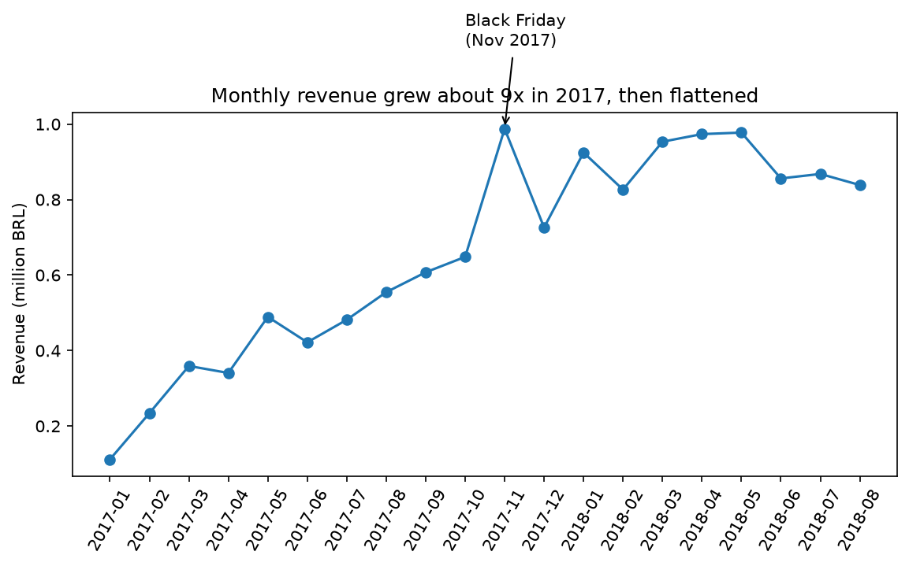
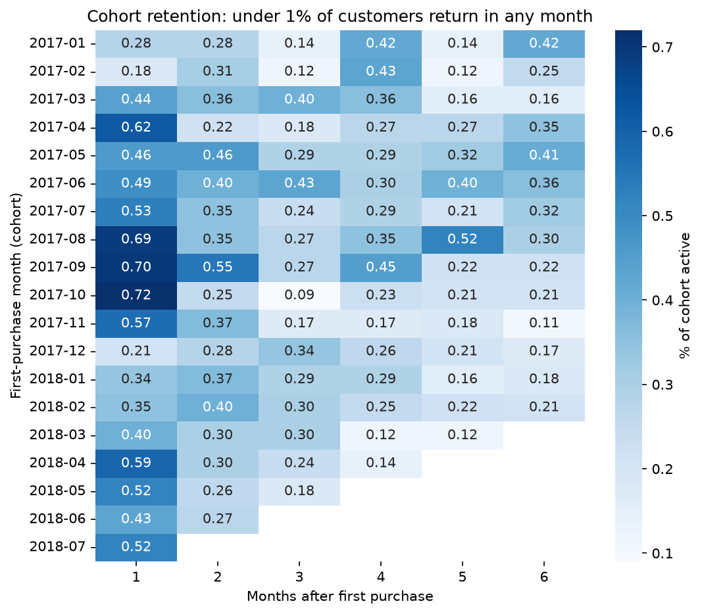
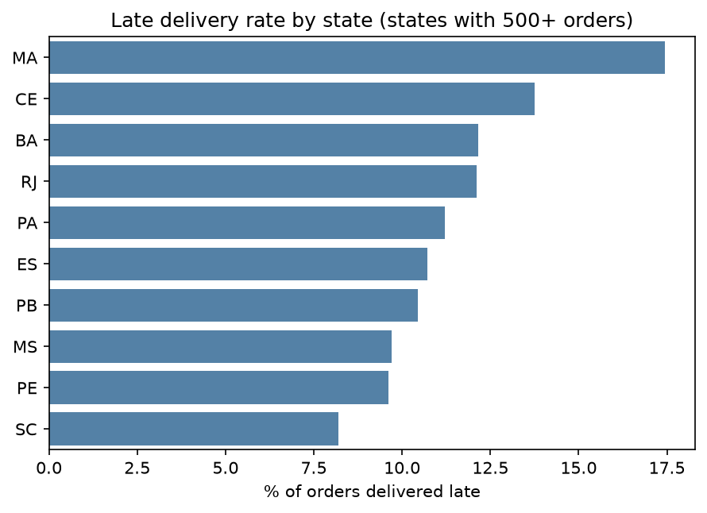
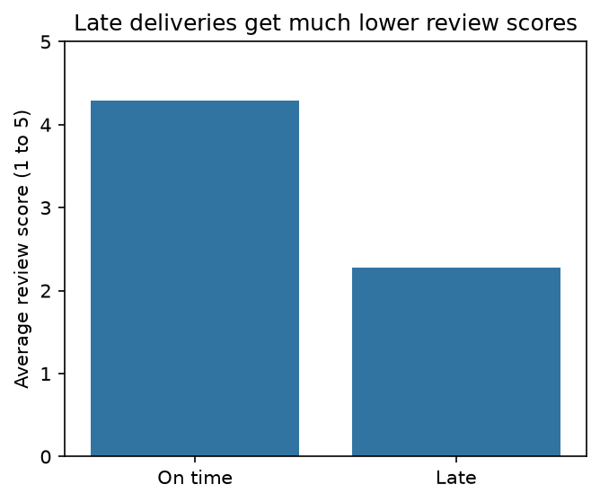

# Olist E-commerce Analysis (SQL + Python)

## Business problem
I analysed about 100k orders from Olist, a Brazilian online marketplace (2016 to 2018),
acting as a data analyst answering three questions from leadership:
1. Where does revenue come from?
2. Are customers coming back?
3. Is delivery performance hurting satisfaction?

## Tools
SQL (SQLite), Python (pandas, matplotlib), Git/GitHub

## Findings so far

### 1. Revenue and growth
- Total revenue is about 13.2M reais (delivered orders, excluding freight).
  *Source: `02_revenue.sql`, total revenue query.*
- Monthly revenue grew almost 9x from Jan 2017 (112k) to Nov 2017 (988k), with a Black Friday
  spike. It then fell 26.5% in December, so the spike was a one-off.
  *Source: `02_revenue.sql`, monthly revenue; `03_growth.sql`, MoM growth.*
- Growth came from order volume, not order value. Average order value stayed around
  125 to 150 reais, while the Nov 2017 jump was a 63% rise in orders.
  *Source: `02_revenue.sql`, monthly orders and AOV.*
- Growth flattened in 2018: monthly revenue stayed between about 0.83M and 0.98M, and MoM
  growth moved between -12% and +15%.
  *Source: `03_growth.sql`, MoM growth.*
- Year-over-year growth slowed from about 100% (May 2018) to 51% (Aug 2018). Early 2018 YoY
  figures are inflated by the small 2017 base.
  *Source: `03_growth.sql`, YoY growth.*
- Cumulative revenue passed 5M in Nov 2017 and 10M in May 2018. The second 5M took 6 months,
  against 11 months for the first.
  *Source: `03_growth.sql`, running total.*

### 2. Categories and sellers
- Revenue is spread across categories: the top 10 make up about 62% of revenue, and the
  largest (health_beauty) is about 9%.
  *Source: `02_revenue.sql`, top 10 categories.*
- The same 3 categories lead in 2017 and 2018. health_beauty grew fastest (about +60%),
  watches_gifts about +45%, and bed_bath_table stalled (about +8.5%). 2018 covers only Jan to
  Aug, so these growth figures are conservative.
  *Source: `04_ranking.sql`, top 3 categories per year.*
- Seller risk: in watches_gifts, the top 3 sellers hold about 47% of category revenue, and in
  bed_bath_table, 2 sellers hold about 31%. The other top categories are spread out. Overall,
  the top 10 sellers earn about 13% of total revenue.
  *Source: `04_ranking.sql`, top sellers per category; `02_revenue.sql`, top 10 sellers.*
- São Paulo state has the most orders (41,746, about 42% of all orders).
  *Source: `02_revenue.sql`, top states.*

### 3. Customer retention
- Only 3.0% of customers (2,801 of 93,358) placed more than one delivered order. With a
  stricter definition (ordering in two or more different months), the figure falls to 1.81%
  (1,693 customers), because about 40% of repeat customers placed all their orders in a single
  month.
  *Source: `05_retention.sql`, repeat customer rate and stricter repeat query.*
- New-customer cohorts grew from 717 (Jan 2017) to 7,060 (Nov 2017), then stayed flat at about
  5.9k to 6.8k per month in 2018. Revenue flattened because customer acquisition flattened.
  *Source: `05_retention.sql`, cohort sizes.*
- Cohort retention is very low: about 0.5% of customers order again in the month after their
  first purchase, with no decay curve afterwards (about 0.1% to 0.7% in months 1 to 6). The
  Black Friday 2017 cohort was no better than the others.
  *Source: `05_retention.sql`, cohort retention table.*
- Implication: growth depends on acquiring new customers every month, not on repeat purchases.
  A post-purchase retention offer could be worth testing.

### 4. Delivery performance
- 6.77% of delivered orders (6,534 of 96,470) arrived after the estimated delivery date.
  *Source: `06_delivery.sql`, late delivery rate.*
- Among states with 500+ orders, the highest late rates are in MA (17.4%), CE (13.8%) and BA
  (12.2%). RJ (12.1% on 12,350 orders) produces about 23% of all late deliveries.
  *Source: `06_delivery.sql`, late rate by state.*
- Estimates are conservative: even in the worst states, orders arrive 10 to 14 days before the
  estimate on average, so late orders are exceptions.
- Late orders average a review score of 2.27, against 4.29 for on-time orders, a gap of about
  2 points. This is an association, not proof of cause.
  *Source: `06_delivery.sql`, review score by delivery status.*
- Implication: a small share of orders (about 7%) drives a large drop in satisfaction, so
  improving delivery in a few high-volume states (RJ, BA) is the most practical target.

## Charts




*Month 0 (always 100%) is omitted so the small retention values are visible.*





## Data quality notes
- Data runs from Sep 2016 to Oct 2018. Sep to Dec 2016 is too sparse to use (Nov 2016 is
  missing), so trend analysis starts from Jan 2017 and ends at Aug 2018. The last months
  (Sep and Oct 2018) have very few delivered orders.
- Revenue figures use delivered orders only and exclude freight.
- 610 products have no category name (about 1.9% of the catalogue). Category analysis
  excludes them, and the category revenues therefore do not add up to total revenue.
  *Source: `01_basics.sql`, data quality checks.*
- 2,965 orders have no delivery date, against 2,963 non-delivered orders, a small mismatch.
  The delivery analysis uses only delivered orders that have a delivery date.
  *Source: `01_basics.sql`.*
- Customers are identified by `customer_unique_id`. The `customer_id` column changes with every
  order, so counting it would hide repeat purchases.

## Project files
| File | What it does |
|---|---|
| `load_data.py` | Loads the Olist CSVs into a SQLite database |
| `01_basics.sql` | Data exploration and data quality checks |
| `02_revenue.sql` | Revenue, average order value, top categories and sellers |
| `03_growth.sql` | CTEs and window functions: MoM growth, running total, YoY growth |
| `04_ranking.sql` | Ranking with PARTITION BY: top categories per year, top sellers per category |
| `05_retention.sql` | Repeat customer rate, cohorts and the cohort retention table |
| `06_delivery.sql` | Delivery performance and review scores  |

## How to reproduce
1. Download the dataset "Brazilian E-Commerce Public Dataset by Olist" from Kaggle and place the
   CSV files in a `data/` folder.
2. Install the requirements:

```
pip install pandas matplotlib seaborn jupyter
```

3. Build the database:

```
python load_data.py
```

4. Open `olist.db` in DB Browser for SQLite (or any SQLite client) and run the `.sql` files.

## Data
Dataset: "Brazilian E-Commerce Public Dataset by Olist" on Kaggle. The data is not included in
this repo.

*Work in progress: delivery analysis, charts and a one-page business summary are next.*